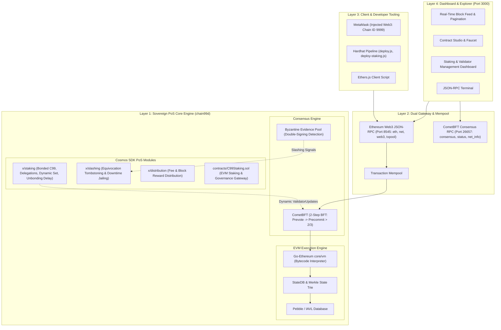

# Chain99 L1 — End-to-End Architecture & Operational Deep Dive

## 1. High-Level Summary
**Chain99** is an independent, sovereign, EVM-compatible Layer 1 blockchain. The network is architected to transition from a single-node Clique Proof-of-Authority (PoA) devnet into a production-grade, multi-validator Proof-of-Stake (PoS) Layer 1:
- **Consensus & Block Production:** CometBFT BFT consensus engine providing 1-block deterministic finality (1–2 seconds) and Byzantine fault tolerance ($N \ge 3f + 1$).
- **Native Staking & Token Economy:** C99 native token with stake-weighted voting power, native delegations, and unbonding lock queues.
- **Dynamic Validator Governance:** Protocol-governed top active validator set (up to 50 nodes) with automated dual-fault slashing (equivocation tombstoning and downtime jailing).
- **EVM Execution Environment:** Full EVM opcode parity via Go-Ethereum's `core/vm`, supporting standard Solidity contracts, Hardhat, Foundry, and MetaMask.
- **Developer & User Tooling:** Integrated Hardhat developer suite, JSON-RPC gateway on port 8545, and an interactive Web Explorer dashboard.

---

## 2. The 4 System Layers (Proof-of-Stake Architecture)



---

## 3. Deep Dive: Layer-by-Layer Breakdown

### Layer 1: Sovereign PoS Engine & State Machine
* **Consensus Engine (CometBFT):**
  - **Deterministic Finality:** Single-block finality with zero probabilistic reorganizations. Blocks are finalized as soon as $> \frac{2}{3}$ of active voting power commits.
  - **Stake-Weighted Voting Power:** Voting power is integer-quantified directly from bonded C99 ($W_i = \text{Bonded\_C99}_i$).
  - **Stake-Weighted Proposer Selection:** Proposers are elected via deterministic weighted round-robin based on priority accumulation.
* **PoS Staking & Validator Governance:**
  - **Self-Bonding & Delegation:** Validators register with a minimum self-bond of 10,000 C99. Token holders delegate C99 to compound validator voting power.
  - **Unbonding Period (Flash-Loan Defense):** Unbonding requests enter a time-lock queue (2 hours on devnet, 14 days on mainnet) preventing flash-loan voting power attacks.
  - **Automated Slashing:**
    - *Double-Signing (Equivocation):* 5.0% slash of bonded stake, permanent tombstoning, and immediate removal from consensus.
    - *Liveness Failure (Downtime):* 0.1% slash and temporary jailing when missing $> 50\%$ of blocks in a 10,000-block window.
* **EVM Execution Environment:**
  - Direct integration with Go-Ethereum's official `core/vm` bytecode engine.
  - Complete support for London/Cancun EVM features (EIP-1559 base fee, transient storage, state gas limits).

---

### Layer 2: Dual Gateway & Mempool
* **Ethereum JSON-RPC Gateway (`http://127.0.0.1:8545`):** Exposes `eth_*`, `net_*`, `web3_*`, and `txpool_*` namespaces.
* **CometBFT RPC (`http://127.0.0.1:26657`):** Exposes consensus health, peer topologies, and validator commit signatures.
* **Transaction Pool:** Validates nonces, balances, and gas limits before gossiping transactions across the P2P network.

---

### Layer 3: Smart Contract & Tooling Integration
Chain99 provides 100% bytecode and tooling compatibility with Ethereum:
1. **Solidity Development:** Standard contracts compile without modification via Hardhat or Foundry:
   - [`Storage.sol`](file:///p:/step_7/chain99-L1-chain/contracts/Storage.sol): Standard application contract.
   - [`C99Staking.sol`](file:///p:/step_7/chain99-L1-chain/contracts/C99Staking.sol): On-chain EVM staking and validator governance contract.
2. **Hardhat Pipeline:** Configured in [`hardhat.config.js`](file:///p:/step_7/chain99-L1-chain/hardhat.config.js) to connect to `http://127.0.0.1:8545` on network `chain99` (Chain ID `9999`).
3. **Execution Instructions:**
   - **Write (`delegate`, `registerValidator`, `set`):** Modifies state via EVM transaction, consumes gas, and is finalized in a 1–2 second BFT block.
   - **Read (`getVotingPower`, `getActiveValidators`, `value`):** Directly queries the state trie via `eth_call` without gas consumption.

---

### Layer 4: Mission Control & Web Explorer (Port 3000)
Interactive explorer dashboard serving:
1. **Live Block Feed:** Displays block height, hash, gas usage, validator commit seals, and transaction throughput.
2. **Validator & Staking Portal:** Real-time visibility into active validators, voting powers, commission rates, and self-bonds.
3. **MetaMask 1-Click Onboarding:** Automatically adds Chain99 (Chain ID `9999`, symbol `C99`).
4. **C99 Faucet:** Dispenses native testnet tokens from the genesis pool.
5. **Contract Studio & JSON-RPC Terminal:** Direct contract interaction and low-level RPC query testing.

---

## 4. Lifecycle: A Transaction From Click to Chain

```text
[User clicks "Delegate 5,000 C99"]
          │
          ▼
1. Signing: Client (MetaMask / Hardhat) signs payload with ECDSA (secp256k1)
          │
          ▼
2. Broadcast: Payload sent to Gateway via HTTP POST eth_sendRawTransaction
          │
          ▼
3. Mempool: Gateway validates signature & nonce; inserts transaction into TxPool
          │
          ▼
4. Proposer Election: CometBFT elects block proposer via stake-weighted priority round-robin
          │
          ▼
5. 2-Step BFT Consensus:
   - Proposer broadcasts candidate block proposal
   - Validators verify proposal & broadcast Prevote (need > 2/3 voting power)
   - Validators broadcast Precommit (need > 2/3 voting power)
          │
          ▼
6. Block Finalization: Block is irrevocably sealed into chaindata; 1-block deterministic finality achieved
          │
          ▼
7. EVM State Transition: EVM executes delegate(); updates C99Staking storage and increments validator voting power
          │
          ▼
8. Dashboard Feed: Web Explorer updates live blocks, contract states, and updated validator voting power
```
