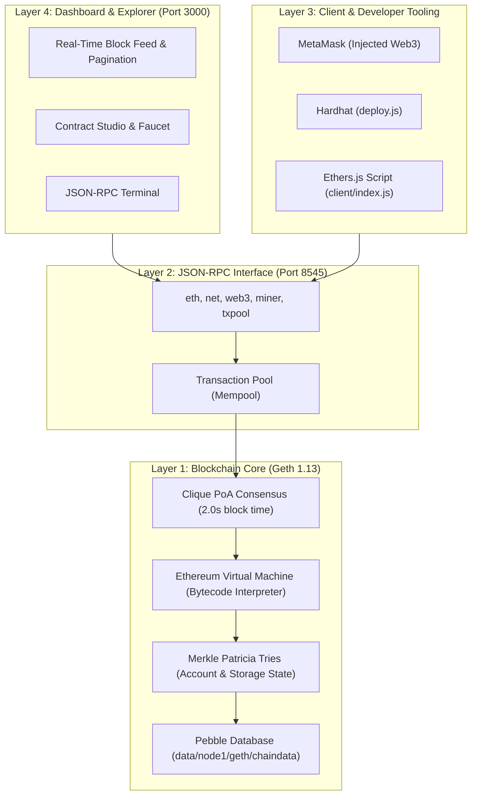

# Chain99 L1 — End-to-End Architecture & Operational Deep Dive

## 1. High-Level Summary
**Chain99** is an independent, sovereign, EVM-compatible Layer 1 blockchain devnet. It demonstrates the complete lifecycle of a decentralized network:
- **Consensus & Block Production:** Go-Ethereum (Geth) running Clique Proof-of-Authority (PoA) with a 2-second block heartbeat.
- **Native Token Economy:** C99 native token with pre-allocated genesis funding.
- **EVM Execution Environment:** Executes standard EVM bytecode, supporting contracts written in Solidity.
- **Developer & User Tooling:** Integrated Hardhat developer suite, MetaMask onboarding, and an interactive Web Explorer dashboard.

---

## 2. The 4 System Layers



---

## 3. Deep Dive: Layer-by-Layer Breakdown

### Layer 1: Blockchain Engine & Genesis State
* **The Binary:** Go-Ethereum (`geth.exe` v1.13.14), the gold standard implementation of Ethereum.
* **The Genesis File (`geth/genesis.json`):** Defines the "Big Bang" of the blockchain:
  - `chainId: 9999`: Ensures replay protection (EIP-155), meaning transactions signed for Chain99 cannot be broadcasted to Ethereum or Polygon.
  - `clique.period: 2`: Directs the validator to produce a new block every 2 seconds.
  - `extradata`: Embeds the validator public address (`0x86fcDCaF0a0C69C30D589e29F85a44a03A40A904`) inside the 32-byte header vanity prefix and 65-byte seal suffix, authorizing it to sign blocks.
  - `alloc`: Pre-funds the validator address with $1,000,000\text{ C99}$ in block #0.
* **Storage Engine:** Geth writes all blockchain blocks and Merkle Patricia Tries into `data/node1/` using PebbleDB.

---

### Layer 2: Network & JSON-RPC Gateway
* Geth exposes an HTTP server on `http://127.0.0.1:8545`.
* **Transaction Pool (Mempool):** When transactions are received, they are verified (signature, nonce, gas limit) and held in the memory pool.
* **Clique Sealer:** Every 2 seconds, the sealer drains valid transactions from the mempool, packages them into a candidate block, executes EVM state transitions, signs the block header using the keystore private key, and broadcasts it to the chain.

---

### Layer 3: Smart Contract & Tooling Integration
Chain99 provides 100% bytecode compatibility with Ethereum:
1. **Solidity Compilation:** `contracts/Storage.sol` is compiled into:
   - **Bytecode:** Raw EVM opcodes (`PUSH1`, `MSTORE`, `SSTORE`, etc.).
   - **ABI:** Interface describing callable functions (`set(uint256)`, `value()`).
2. **Hardhat Pipeline (`hardhat.config.js`):** Configured to connect directly to `http://127.0.0.1:8545` on network `chain99` using the unlocked validator private key.
3. **Execution Instructions:**
   - **Write (`set`):** Modifies contract storage slot 0 via EVM opcode `SSTORE`. Consumes gas and is sealed in a 2-second block.
   - **Read (`value`):** Directly queries the state trie via `eth_call` (opcode `SLOAD`) without gas or transaction submission.

---

### Layer 4: Mission Control & Web Explorer (Port 3000)
A pure Node.js server with zero runtime dependencies serving:
1. **Real-Time Block Feed:** Live visualizer showing block sealing, gas consumption, and active transaction counts.
2. **History Pagination:** Step backward across thousands of blocks, or jump directly to any block height (e.g. #1021).
3. **Etherscan-Style Modal:** Deconstructs raw RPC hex payloads into formatted timestamps, state roots, and transaction flow cards.
4. **C99 Faucet:** Dispenses native tokens from the validator pool to any browser address.
5. **Contract Studio:** Web3 dApp interface allowing users to deploy and interact with contracts directly in the browser.
6. **JSON-RPC Terminal:** Low-level developer playground to test custom RPC queries.

---

## 4. Lifecycle: A Transaction From Click to Chain

```text
[User clicks "set(420)"]
          │
          ▼
1. Signing: Client (Hardhat / MetaMask) signs payload with ECDSA (secp256k1)
          │
          ▼
2. Broadcast: Payload sent to Geth via HTTP POST `eth_sendRawTransaction`
          │
          ▼
3. Mempool: Geth validates signature & nonce; places tx in TxPool
          │
          ▼
4. EVM Execution: Miner executes EVM opcodes; updates Storage Slot 0 to 420; deducts gas
          │
          ▼
5. State Root: New Merkle Trie root hash generated for contract storage
          │
          ▼
6. Clique Seal: Validator signs block header; block is sealed into chaindata
          │
          ▼
7. Dashboard: Web explorer receives block receipt; UI updates stored value to 420
```
