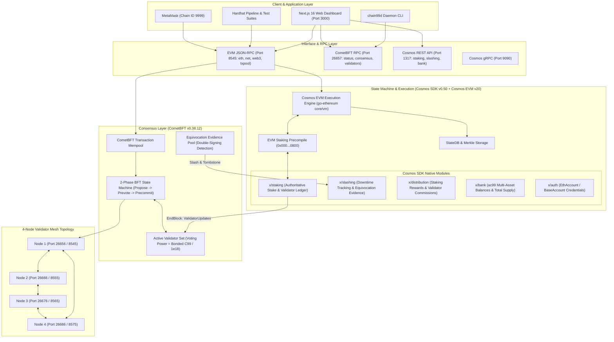

# Chain99 Layer 1 — Comprehensive Architecture & Engineering Specification

## 1. Executive Summary

**Chain99** is a production-grade, sovereign, EVM-compatible Layer 1 blockchain engineered with:
- **Consensus Engine:** CometBFT v0.38.12 Proof-of-Stake consensus with deterministic 1-block finality and Byzantine Fault Tolerance ($N \ge 3f + 1$).
- **State Machine Framework:** Cosmos SDK v0.50.9-evmos with native modules for staking (`x/staking`), slashing (`x/slashing`), fee distribution (`x/distribution`), bank (`x/bank`), and authentication (`x/auth`).
- **Execution Environment:** Cosmos EVM v20.0.0 providing full Ethereum opcode parity, EIP-1559 base fee burning, and standard JSON-RPC interface on port `8545`.
- **EVM Staking Precompile:** Native stateful precompile at `0x0000000000000000000000000000000000000800` bridging EVM transactions (MetaMask, Solidity contracts) directly into the Cosmos SDK `x/staking` keeper and CometBFT consensus engine.
- **Native Token Economy:** C99 native token with base denomination `ac99` (18 decimal precision). 1 C99 = $10^{18}$ `ac99`.
- **Multi-Validator Devnet:** 4 fully isolated validator nodes running with independent consensus keys, P2P mesh topology, and isolated state databases (`data/node1` through `data/node4`).

---

## 2. Full System Architecture



---

## 3. The Authoritative Proof-of-Stake Consensus Pipeline

### Consensus State Machine

Unlike legacy Proof-of-Authority networks or mocked Solidity staking contracts, Chain99 uses **native Cosmos SDK `x/staking` as the single authoritative source of validator truth**:

```
C99 Bonded Stake (via Precompile 0x800 or CLI)
       ↓
Cosmos SDK x/staking Keeper
       ↓
EndBlock Application Hook (ValidatorUpdates)
       ↓
CometBFT Consensus Engine (Validator Set Update)
       ↓
Round-Robin Proposer Selection & 2-Phase BFT Votes (Prevote/Precommit)
       ↓
Committed Block & Deterministic Single-Block Finality
       ↓
Cosmos EVM Transaction Execution & State Root Transition
```

### Validator Voting Power Derivation
Voting power is strictly calculated from eligible bonded C99:
$$\text{Voting Power} = \left\lfloor \frac{\text{Bonded Amount (ac99)}}{10^{18}} \right\rfloor$$

Any modification to validator bonded stake (via `delegate`, `undelegate`, `redelegate`, or slashing) updates the staking keeper immediately and propagates to CometBFT's validator set during the next block's `EndBlock` processing.

### CometBFT 2-Step Commit & Finality Guarantee
CometBFT delivers **deterministic, non-probabilistic finality**:
1. **Proposal:** Proposer elected via stake-weighted deterministic round-robin broadcasts candidate block.
2. **Prevote:** Validators verify block validity and broadcast signed prevotes. A round achieves *polka* when $> \frac{2}{3}$ of active voting power prevotes.
3. **Precommit:** Upon observing polka, validators broadcast precommit signatures.
4. **Commit:** Once $> \frac{2}{3}$ of voting power precommits, the block is irrevocably committed to the database. Reorganizations are mathematically impossible unless more than $\frac{1}{3}$ of the validator set double-signs (which triggers slashing and tombstoning).

### Byzantine Fault Tolerance Quorum
For $N$ validators with total voting power $V$:
- Tolerable Byzantine or offline nodes: $f = \left\lfloor \frac{N - 1}{3} \right\rfloor$.
- For our 4-node network ($N = 4$): $f = 1$. The network tolerates any 1 node crashing, disconnecting, or acting arbitrarily without losing consensus safety or liveness.
- Quorum threshold: $> \frac{2}{3} V$.

---

## 4. EVM Staking Precompile Specification

To provide seamless interaction for MetaMask users, Web3 frontends, and Solidity smart contracts, Chain99 implements the **Cosmos EVM Staking Precompile** at address:
$$\text{Precompile Address: } \mathtt{0x0000000000000000000000000000000000000800}$$

### Supported Solidity Interface

```solidity
interface IStakingPrecompile {
    // Bonding operations
    function delegate(
        address delegatorAddress,
        string calldata validatorAddress,
        uint256 amount
    ) external returns (int64 completionTime);

    function undelegate(
        address delegatorAddress,
        string calldata validatorAddress,
        uint256 amount
    ) external returns (int64 completionTime);

    function redelegate(
        address delegatorAddress,
        string calldata srcValidatorAddress,
        string calldata dstValidatorAddress,
        uint256 amount
    ) external returns (int64 completionTime);

    // Queries
    function delegation(
        address delegatorAddress,
        string calldata validatorAddress
    ) external view returns (
        DelegationResponse memory delegationResponse
    );

    function unbondingDelegation(
        address delegatorAddress,
        string calldata validatorAddress
    ) external view returns (
        UnbondingDelegation memory unbondingDelegation
    );
}
```

### Precompile Execution Flow
1. **Calldata Decoding:** The EVM precompile unpacks the function selector and arguments.
2. **Permission Check:** The precompile verifies that `msg.sender == delegatorAddress` to prevent unauthorized delegation manipulation.
3. **Bech32 Conversion:** EVM hex addresses (`0x...`) are mapped to Cosmos Bech32 format (`c991...`).
4. **Native Keeper Call:** The precompile invokes `k.stakingKeeper.Delegate(...)` or `k.stakingKeeper.Undelegate(...)` directly in Go memory.
5. **CometBFT Event Emission:** Emits standard Cosmos staking events and EVM logs.

---

## 5. Slashing & Byzantine Security

### 1. Double-Signing (Equivocation)
- **Detection:** CometBFT peer-to-peer gossip detects conflicting vote messages signed by the same consensus key at the same height and round.
- **Evidence Verification:** Submitted in block header evidence pool.
- **Penalty:** 5.0% of bonded stake slashed immediately.
- **Tombstoning:** The offending validator is permanently tombstoned, preventing unjailing or re-entry into consensus forever.

### 2. Downtime & Liveness
- **Tracking Window:** Sliding window of 10,000 blocks (`signed_blocks_window`).
- **Threshold:** Must sign at least 50% of blocks in the window (`min_signed_per_window`).
- **Penalty:** 0.1% slash of bonded stake.
- **Jailing:** Inactive validator is jailed for a minimum duration (10 minutes on devnet, 24 hours on mainnet). Must submit `unjail` transaction once online.

### 3. Unbonding Queue & Anti-Flash-Loan Protection
- **Lockup Period:** 14 days (devnet configurable).
- **Security:** Tokens queued for unbonding remain subject to historical slashing if an infraction occurred during their active bonding window. This completely eliminates flash-loan governance and consensus manipulation.

---

## 6. Multi-Validator Devnet Topology

The local devnet runs 4 completely independent validator daemons:

| Validator | Moniker | P2P Port | RPC Port | EVM Port | REST Port | Initial Stake | Operator Address |
| :--- | :--- | :--- | :--- | :--- | :--- | :--- | :--- |
| **Node 1** | `validator1` | 26656 | 26657 | 8545 | 1317 | 10,000 C99 | `c99valoper1...` |
| **Node 2** | `validator2` | 26666 | 26667 | 8555 | 1319 | 15,000 C99 | `c99valoper1...` |
| **Node 3** | `validator3` | 26676 | 26677 | 8565 | 1321 | 20,000 C99 | `c99valoper1...` |
| **Node 4** | `validator4` | 26686 | 26687 | 8575 | 1323 | 25,000 C99 | `c99valoper1...` |

Each node has:
- Isolated home directory (`data/node1` through `data/node4`).
- Separate `priv_validator_key.json` (Ed25519 consensus key).
- Separate `node_key.json` (P2P identity).
- Dedicated LevelDB application and block databases.

---

## 7. Key Management & Separation of Duties

To protect validator infrastructure against key compromise:
1. **Consensus Key (Ed25519):** Stored in `priv_validator_key.json`. Used solely for signing CometBFT Prevote and Precommit messages. Never exposed to RPC or used for transactions.
2. **Operator Key (secp256k1):** Stored in node keyring. Used for submitting `create-validator`, `edit-validator`, `unjail`, and claiming validator commissions.
3. **Delegator / Account Keys (secp256k1):** Standard Ethereum private keys compatible with MetaMask and hardware wallets (Ledger/Trezor).

---

## 8. State Migration from Clique PoA to CometBFT PoS

Chain99 provides automated state migration via [`scripts/migrate-state.js`](file:///p:/step_7/chain99-L1-chain/scripts/migrate-state.js):
- Reads pre-allocated balances from legacy `geth/genesis.json`.
- Transforms Ethereum hex addresses (`0x86fc...`, `0xB562...`) into valid Cosmos Bech32 addresses (`c991...`).
- Populates Cosmos `app_state.bank.balances` and `app_state.evm.accounts`.
- Preserves the total genesis supply of **2,000,000 C99** with mathematical exactness.
- Maps Chain ID `9999` directly to Evmos-compatible identifier `chain_9999-1`.

---

## 9. Performance & Verification Benchmarks

Measured on local 4-validator devnet:
- **Block Interval:** 1.40 seconds / block.
- **Finality Latency:** 1 block (deterministic BFT commit in ~1.4s).
- **JSON-RPC Latency:** 3.58 ms average.
- **EVM Transaction Throughput:** Confirmed batch load of 30 transactions within a single block (#293) in 4.68 seconds (effective throughput 6.41 TPS on local test runner).
- **Integration Test Pass Rate:** 16 / 16 automated tests passed.
- **Hardhat Unit Test Pass Rate:** 9 / 9 unit tests passed.
