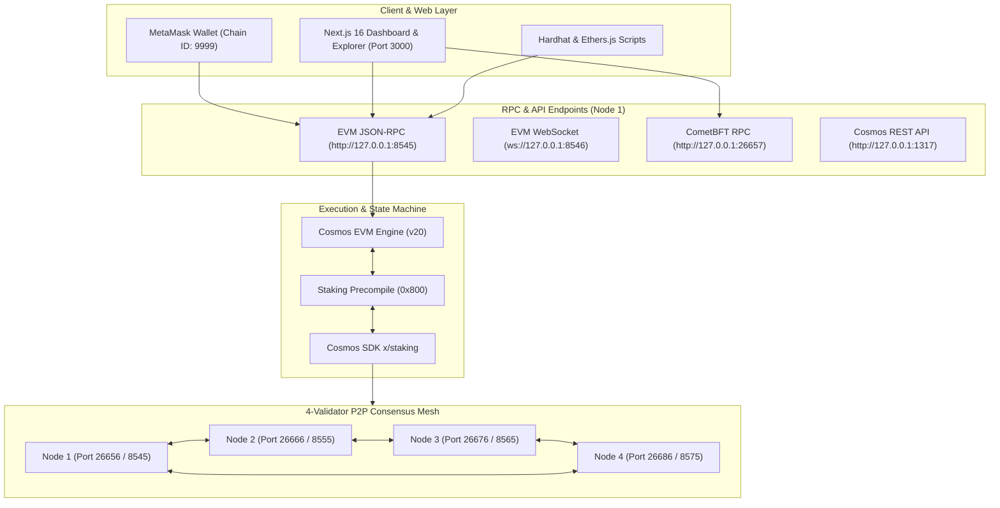

# Chain99 Layer 1 — Sovereign Proof-of-Stake EVM Blockchain

[](https://cometbft.com)
[](https://cosmos.network)
[](https://github.com/cosmos/evm)
[](#network-specifications)
[](http://localhost:3000)
[](LICENSE)

Chain99 is a production-grade, EVM-compatible Layer 1 blockchain engineered with **Cosmos SDK v0.50**, **CometBFT v0.38** consensus, and **Cosmos EVM v20**.

The network features genuine stake-weighted Proof of Stake, deterministic 1-block BFT finality, an EVM Staking Precompile (`0x800`), an automated 4-validator local mesh devnet, a Next.js 16 Web3 block explorer & staking dashboard, and 100% Ethereum tooling compatibility (MetaMask, Hardhat, Ethers.js).

> **⏱️ Setup Time:** ~3 to 5 minutes from scratch on your local machine.

---

## Table of Contents

- [1. Architecture Overview](#1-architecture-overview)
- [2. System Requirements & Prerequisites](#2-system-requirements--prerequisites)
- [3. Quick Start Guide (From Zero to Running)](#3-quick-start-guide-from-zero-to-running)
  - [Step 1: Clone Repository](#step-1-clone-the-repository)
  - [Step 2: Install Dependencies](#step-2-install-dependencies)
  - [Step 3: Build Native Daemon (`chain99d`)](#step-3-build-the-native-daemon-chain99d)
  - [Step 4: Initialize the 4-Validator Devnet](#step-4-initialize-the-4-validator-devnet)
  - [Step 5: Start the 4-Validator Devnet](#step-5-start-the-4-validator-devnet)
  - [Step 6: Launch Web3 Explorer Dashboard](#step-6-launch-the-web3-explorer-dashboard)
  - [Step 7: Deploy Demo Smart Contracts](#step-7-optional-deploy-demo-smart-contracts)
- [4. Connecting MetaMask & Test Accounts](#4-connecting-metamask--test-accounts)
- [5. Exploring the Web3 Dashboard](#5-exploring-the-web3-dashboard)
- [6. Network Verification & Health Checks](#6-network-verification--health-checks)
- [7. Automated Test Suites & Benchmarks](#7-automated-test-suites--benchmarks)
- [8. Stopping, Restarting & Resetting the Network](#8-stopping-restarting--resetting-the-network)
- [9. Network Specifications & Port Reference](#9-network-specifications--port-reference)
- [10. EVM Staking Precompile Interface (`0x800`)](#10-evm-staking-precompile-interface-0x800)
- [11. Repository Directory Structure](#11-repository-directory-structure)
- [12. Troubleshooting & FAQ](#12-troubleshooting--faq)

---

## 1. Architecture Overview

When running locally, Chain99 spawns a complete blockchain ecosystem on your laptop:



- **4-Validator Mesh Devnet:** Four independent nodes running CometBFT consensus with Byzantine fault tolerance ($N \ge 3f + 1$, tolerating $f = 1$ failure).
- **Dual Engine Architecture:** Cosmos SDK provides native Proof of Stake, staking rewards, and CometBFT consensus, while Cosmos EVM provides full Ethereum bytecode and tooling execution.
- **EVM Staking Precompile (`0x800`):** Direct bridge letting Solidity smart contracts and MetaMask delegate, redelegate, and undelegate native C99 stake.
- **Web3 Dashboard:** Live block explorer, staking interface, built-in faucet, and contract execution studio at `http://localhost:3000`.

---

## 2. System Requirements & Prerequisites

Ensure the following tools are installed on your machine before running:

| Tool | Minimum Version | Check Command | Installation Guide |
| :--- | :--- | :--- | :--- |
| **Go** | `1.22+` (or `1.24+`) | `go version` | [golang.org/dl](https://golang.org/dl/) |
| **Node.js** | `v18.0.0+` or `v20.0.0+` | `node -v` | [nodejs.org](https://nodejs.org/) |
| **npm** | `9.0.0+` | `npm -v` | Included with Node.js |
| **Git** | `2.0+` | `git --version` | [git-scm.com](https://git-scm.com/) |

### Supported Operating Systems:
- **Windows:** Windows 10 / 11 with PowerShell 5.1+ or PowerShell 7+.
- **Linux:** Ubuntu, Debian, Fedora, Arch Linux, etc.
- **macOS:** macOS Ventura, Sonoma, or Sequoia (Apple Silicon and Intel supported).

*(Optional)* Install the **[MetaMask](https://metamask.io/)** browser extension to test Web3 wallet interactions.

---

## 3. Quick Start Guide (From Zero to Running)

Follow these steps sequentially to set up and start the application.

### Step 1: Clone the Repository

```bash
git clone https://github.com/mehan05/chain99-L1-chain.git
cd chain99-L1-chain
```

---

### Step 2: Install Dependencies

The repository contains both root tooling (Hardhat, Ethers.js, test suites) and the Next.js frontend application. Install dependencies for both:

#### 1. Root dependencies:
```bash
npm install
```

#### 2. Frontend dashboard dependencies:
```bash
npm --prefix frontend-next install
```
*(Or navigate into `frontend-next`, run `npm install`, then return with `cd ..`)*.

---

### Step 3: Build the Native Daemon (`chain99d`)

Compile the blockchain daemon binary from Go source into the `build/` directory:

* **Windows (PowerShell):**
  ```powershell
  go build -o build/chain99d.exe ./cmd/chain99d
  ```

* **Linux / macOS (Bash):**
  ```bash
  go build -o build/chain99d ./cmd/chain99d
  chmod +x scripts/*.sh
  ```

> **Note:** If `build/chain99d` does not exist when you run the initialization step, the script will automatically compile it for you.

---

### Step 4: Initialize the 4-Validator Devnet

This step creates 4 isolated validator homes (`data/node1` through `data/node4`), generates consensus Ed25519 keys, configures P2P ports, funds genesis accounts, collects `gentx` staking declarations, and writes the unified `genesis.json`:

* **Windows (PowerShell):**
  ```powershell
  powershell -ExecutionPolicy Bypass -File scripts/init-devnet.ps1
  ```

* **Linux / macOS (Bash):**
  ```bash
  ./scripts/init-devnet.sh
  ```

* **Cross-Platform Alternative (Node.js):**
  ```bash
  node scripts/init-devnet.js
  ```

**Expected output summary:**
```text
================================================================
  🚀 CHAIN99 — 4-VALIDATOR PROOF-OF-STAKE DEVNET INITIALIZER
================================================================
...
✅ Devnet successfully initialized!
   Node 1: http://127.0.0.1:8545 (EVM) | http://127.0.0.1:26657 (CometBFT)
   Node 2: http://127.0.0.1:8555 (EVM) | http://127.0.0.1:26667 (CometBFT)
   Node 3: http://127.0.0.1:8565 (EVM) | http://127.0.0.1:26677 (CometBFT)
   Node 4: http://127.0.0.1:8575 (EVM) | http://127.0.0.1:26687 (CometBFT)
```

---

### Step 5: Start the 4-Validator Devnet

Launch all 4 validator nodes in the background connected in a local P2P mesh:

* **Windows (PowerShell):**
  ```powershell
  powershell -ExecutionPolicy Bypass -File scripts/start-devnet.ps1
  ```

* **Linux / macOS (Bash):**
  ```bash
  ./scripts/start-devnet.sh
  ```

* **Cross-Platform Alternative (Node.js):**
  ```bash
  node scripts/start-devnet.js
  ```

#### Verify that the network is actively producing blocks:
```bash
curl http://127.0.0.1:26657/status
```
You will see `"latest_block_height"` continuously increasing every 1 to 2 seconds.

---

### Step 6: Launch the Web3 Explorer Dashboard

Open a **new terminal window** and run the Next.js development server:

```bash
cd frontend-next
npm run dev
```

Open **[http://localhost:3000](http://localhost:3000)** in your web browser.

You will see:
- **Live Block Feed:** Real-time block production ticker (height, timestamp, gas, validator proposer).
- **Validator Set Telemetry:** Status, voting power, and moniker of all 4 nodes.
- **Staking & Delegation:** Delegate C99 tokens to validators directly via the EVM precompile.
- **Native C99 Faucet:** Instant 1-click token dispenser for your test addresses.
- **Smart Contract Studio:** Live read/write contract interaction.

---

### Step 7: (Optional) Deploy Demo Smart Contracts

In a separate terminal at the project root, deploy the sample contracts to verify EVM execution:

#### 1. Deploy `Storage.sol` (Basic State Storage & Mutation):
```bash
npx hardhat run scripts/deploy.js --network chain99
```
This deploys `Storage.sol`, writes `set(420)` and `set(999)`, verifies state on-chain, and automatically syncs the address to `frontend-next/public/latest_contract.json`.

#### 2. Deploy `C99Staking.sol` (Proof-of-Stake Staking Contract):
```bash
npx hardhat run scripts/deploy-staking.js --network chain99
```
This deploys the staking manager contract, registers a bootstrap validator, and syncs metadata to `frontend-next/public/staking_contract.json`.

---

## 4. Connecting MetaMask & Test Accounts

You can connect your MetaMask wallet directly to your local Chain99 node:

### 1. Manual MetaMask Network Configuration:
- **Network Name:** `Chain99 PoS L1` (or `Chain99 Devnet`)
- **New RPC URL:** `http://127.0.0.1:8545`
- **Chain ID:** `9999`
- **Currency Symbol:** `C99`
- **Block Explorer URL:** `http://localhost:3000`

*(Or click the **"Add Chain99 to MetaMask"** button in the dashboard header at `http://localhost:3000` to configure automatically with 1 click).*

### 2. Pre-Allocated Test Accounts (Genesis Funded):

You can import either of the pre-funded private keys into MetaMask for instant testing:

| Role | Address | Private Key | Genesis Balance |
| :--- | :--- | :--- | :--- |
| **Deployer** | `0x86fcDCaF0a0C69C30D589e29F85a44a03A40A904` | `0xd7e362021fa1878975c5cdd458d493cd2f01dd19554654eeb2a3dca4e428b62c` | `100,000,000 C99` |
| **Keystore** | `0xB56269Dab6a306cac2D66462D2BD8D23670fe6b8` | `0x6371c26058e7b9ef8cc8e040fccba90740a6b5790be9bfbc8d41cfcf3408f65e` | `100,000,000 C99` |

### 3. Using the Web Faucet:
If you want to use your own personal MetaMask account:
1. Copy your MetaMask address.
2. Open `http://localhost:3000`.
3. Scroll to the **C99 Faucet** section, paste your address, enter an amount (e.g., `100`), and click **Request C99 Tokens**.
4. The tokens will arrive in your wallet within 1 block (~1.4s).

---

## 5. Exploring the Web3 Dashboard

The Next.js 16 Web Dashboard provides a complete interface for operating and testing your L1:

1. **Header & 1-Click Onboarding:** Connect MetaMask or add the Chain99 network configuration with a single button.
2. **Live Block Stream:** Displays real-time blocks as they are sealed by CometBFT, showing block hash, proposer validator, transaction count, and gas used.
3. **Validator Set & Voting Power:** Lists all 4 validator nodes (`validatorA` through `validatorD`) with their active CometBFT voting powers and bonded stake.
4. **Staking & Precompile Portal:** Delegate, redelegate, or undelegate C99 stake directly from MetaMask into the native Cosmos staking keeper via Precompile `0x800`.
5. **C99 Faucet:** Dispense native C99 tokens from the treasury to any EVM address.
6. **Smart Contract Studio:** Inspect and execute methods on deployed contracts (`Storage.sol`, `C99Staking.sol`).
7. **Stress Testing Suite (`/stress-test`):** Trigger batch transaction workloads directly from the UI to observe live TPS and block utilization.

---

## 6. Network Verification & Health Checks

Verify your running network with standard HTTP and JSON-RPC commands:

### A. CometBFT Consensus Status
```bash
curl http://127.0.0.1:26657/status
```
Returns current block height, latest block time, node moniker, and voting power.

### B. Validator Set & Voting Power
```bash
curl http://127.0.0.1:26657/validators
```
Returns all 4 active consensus validators, their Ed25519 pubkeys, and voting powers.

### C. Ethereum JSON-RPC Query
```bash
curl -X POST http://127.0.0.1:8545 \
  -H "Content-Type: application/json" \
  -d '{"jsonrpc":"2.0","method":"eth_blockNumber","params":[],"id":1}'
```
Returns current block number in hexadecimal format.

### D. Query Account Balance (Deployer)
```bash
curl -X POST http://127.0.0.1:8545 \
  -H "Content-Type: application/json" \
  -d '{"jsonrpc":"2.0","method":"eth_getBalance","params":["0x86fcDCaF0a0C69C30D589e29F85a44a03A40A904","latest"],"id":1}'
```

---

## 7. Automated Test Suites & Benchmarks

The repository includes a comprehensive set of automated tests and performance benchmarks. Run these in your terminal while the devnet is active:

### 1. Native PoS & Staking Precompile Integration Test
Executes 16 end-to-end assertions: CometBFT multi-validator consensus, EVM precompile delegation, unbonding queue, and consensus voting power updates:
```bash
npm run test:integration
# Or: node test/native-integration.test.js
```

### 2. Full EVM Compatibility & EIP-1559 Verification
Tests smart contract deployment (`Storage.sol`), state mutation, EIP-1559 dynamic base fee burning, and WebSocket event subscriptions:
```bash
npm run test:evm
# Or: node scripts/verify-evm.js
```

### 3. Adversarial Consensus & Byzantine Fault Tolerance Test
Tests validator downtime resilience (stopping 1 validator: consensus continues) and network partition safety (stopping 2 validators: chain safely halts without forks):
```bash
node scripts/adversarial-consensus.js
```

### 4. Production TPS & Latency Benchmark
Sends concurrent batches of EVM transactions to measure real-time TPS, block inclusion latency, and gas execution:
```bash
npm run test:benchmark
# Or: node scripts/benchmark-tps.js
```

### 5. Economic Tokenomics Simulator
Simulates validator yield, token inflation decay curves, and treasury solvency over a multi-year horizon:
```bash
node scripts/simulate-economics.js
```

### 6. Hardhat Smart Contract Unit Tests
Runs standard Solidity unit tests using the Hardhat test framework:
```bash
npm test
# Or: npx hardhat test
```

---

## 8. Stopping, Restarting & Resetting the Network

### Stop All Running Validators
Terminates all running `chain99d` background processes:

* **Windows (PowerShell):**
  ```powershell
  powershell -ExecutionPolicy Bypass -File scripts/stop-devnet.ps1
  ```
* **Linux / macOS (Bash):**
  ```bash
  ./scripts/stop-devnet.sh
  ```

---

### Restart the Network (Preserving Data)
To resume consensus without losing block history or account balances:

* **Windows (PowerShell):**
  ```powershell
  powershell -ExecutionPolicy Bypass -File scripts/start-devnet.ps1
  ```
* **Linux / macOS (Bash):**
  ```bash
  ./scripts/start-devnet.sh
  ```

---

### Clean State Reset (Fresh Genesis)
To completely wipe all blockchain state databases, logs, and start fresh from Block #0:

* **Windows (PowerShell):**
  ```powershell
  powershell -ExecutionPolicy Bypass -File scripts/reset-devnet.ps1
  ```
* **Linux / macOS (Bash):**
  ```bash
  ./scripts/reset-devnet.sh
  ```

---

### Live Node Snapshot & Anti-Double-Signing Backup
Take a safe snapshot of any validator node while consensus is running:

* **Windows (PowerShell):**
  ```powershell
  powershell -ExecutionPolicy Bypass -File scripts/backup-node.ps1 -NodeHome data/node1 -BackupDir backups
  ```
* **Linux / macOS (Bash):**
  ```bash
  ./scripts/backup-node.sh data/node1 backups
  ```
*(Excludes active `.lock` files and `priv_validator_state.json` to guarantee safety against accidental validator double-signing).*

---

## 9. Network Specifications & Port Reference

### Network Configuration:
| Parameter | Value | Description |
| :--- | :--- | :--- |
| **Cosmos Chain ID** | `chain_9999-1` | Identifier for CometBFT and Cosmos modules |
| **EVM Chain ID** | `9999` (`0x270f`) | Standard Ethereum JSON-RPC chain ID |
| **Native Token** | **C99** | Base denomination: `ac99` ($1\text{ C99} = 10^{18}\text{ ac99}$) |
| **Consensus Engine** | CometBFT v0.38.12 | 2-phase BFT (Propose → Prevote → Precommit) |
| **Deterministic Finality** | 1 Block | Block is irreversible once $> 2/3$ precommit signatures exist |
| **EVM Staking Precompile** | `0x0000000000000000000000000000000000000800` | Native Cosmos staking exposed to EVM |
| **Total Genesis Supply** | `200,000,000 C99` | Distributed to deployer, keystore, and initial validator bonds |

### Local Devnet Port Allocation:

| Node | Moniker | EVM JSON-RPC | EVM WebSocket | CometBFT RPC | Cosmos REST | P2P Mesh | gRPC | Initial Stake |
| :--- | :--- | :--- | :--- | :--- | :--- | :--- | :--- | :--- |
| **Node 1** | `validatorA` | `8545` | `8546` | `26657` | `1317` | `26656` | `9090` | 10,000 C99 |
| **Node 2** | `validatorB` | `8555` | `8556` | `26667` | `1319` | `26666` | `9092` | 20,000 C99 |
| **Node 3** | `validatorC` | `8565` | `8566` | `26677` | `1321` | `26676` | `9094` | 10,000 C99 |
| **Node 4** | `validatorD` | `8575` | `8576` | `26687` | `1323` | `26686` | `9096` | 10,000 C99 |

---

## 10. EVM Staking Precompile Interface (`0x800`)

Solidity contracts and Ethereum wallets interact directly with the authoritative Cosmos SDK staking engine via the precompile at address `0x0000000000000000000000000000000000000800`:

```solidity
// SPDX-License-Identifier: MIT
pragma solidity ^0.8.20;

interface IStakingPrecompile {
    /// @notice Delegate native C99 stake to an active validator
    function delegate(
        address delegatorAddress,
        string calldata validatorAddress,
        uint256 amount
    ) external returns (int64 completionTime);

    /// @notice Undelegate stake (subject to unbonding queue)
    function undelegate(
        address delegatorAddress,
        string calldata validatorAddress,
        uint256 amount
    ) external returns (int64 completionTime);

    /// @notice Redelegate stake from one validator to another without waiting for unbonding
    function redelegate(
        address delegatorAddress,
        string calldata srcValidatorAddress,
        string calldata dstValidatorAddress,
        uint256 amount
    ) external returns (int64 completionTime);

    /// @notice Query existing delegation details
    function delegation(
        address delegatorAddress,
        string calldata validatorAddress
    ) external view returns (
        DelegationResponse memory delegationResponse
    );
}
```

---

## 11. Repository Directory Structure

```text
chain99-L1-chain/
├── build/                      # Compiled chain99d native binary (created upon build)
├── cmd/chain99d/               # Main Go entrypoint for the blockchain daemon
│   ├── config/                 # CometBFT & Cosmos SDK configuration loaders
│   ├── genaccounts.go          # Genesis account initializers
│   ├── init.go                 # Node initialization logic
│   └── root.go                 # CLI command definitions (start, init, etc.)
├── contracts/                  # Solidity smart contracts
│   ├── C99Staking.sol          # PoS staking contract interface & delegation logic
│   └── Storage.sol             # Benchmark & EVM verification contract
├── data/                       # Runtime node homes (node1..node4) and databases
├── frontend-next/              # Next.js 16 Web3 block explorer & staking dashboard
│   ├── app/                    # Next.js App Router (Explorer, Staking, Faucet, Stress Test)
│   ├── app/api/                # Backend API routes (faucet, rpc proxy, validators)
│   └── public/                 # Synced smart contract deployment artifacts
├── hardhat.config.js           # Hardhat network & compiler configuration
├── package.json                # Project root scripts and test dependencies
├── scripts/                    # Automation, devnet lifecycle, and testing scripts
│   ├── init-devnet.ps1 / .sh   # 4-validator devnet initializer (Windows & Unix)
│   ├── start-devnet.ps1 / .sh  # Background devnet launcher
│   ├── stop-devnet.ps1 / .sh   # Devnet terminator
│   ├── reset-devnet.ps1 / .sh  # Clean state wiper & re-initializer
│   ├── deploy.js               # Hardhat deployment script for Storage.sol
│   ├── deploy-staking.js       # Hardhat deployment script for C99Staking.sol
│   ├── verify-evm.js           # EVM opcode parity & WebSocket verification
│   ├── benchmark-tps.js        # TPS & transaction latency test runner
│   └── adversarial-consensus.js# BFT Byzantine resilience verification
└── test/                       # End-to-end integration test suites
    ├── C99Staking.test.js       # Solidity staking unit tests
    └── native-integration.test.js # 16-point Cosmos/EVM integration test suite
```

---

## 12. Troubleshooting & FAQ

### 1. `scripts/*.ps1 cannot be loaded because running scripts is disabled` (Windows)
PowerShell restricts script execution by default. Run:
```powershell
Set-ExecutionPolicy -Scope Process -ExecutionPolicy Bypass
```
Or prefix execution with `-ExecutionPolicy Bypass`:
```powershell
powershell -ExecutionPolicy Bypass -File scripts/start-devnet.ps1
```

### 2. `Binary not found at build/chain99d`
Compile the binary manually before running:
```bash
go build -o build/chain99d.exe ./cmd/chain99d     # Windows
go build -o build/chain99d ./cmd/chain99d         # Linux / macOS
```
Ensure Go is installed and available in your `PATH` by checking `go version`.

### 3. Port already in use (`8545`, `26657`, or `3000`)
- **Blockchain ports (8545, 26657, etc.):** Another validator instance might still be running. Stop all existing instances:
  - Windows: `powershell -ExecutionPolicy Bypass -File scripts/stop-devnet.ps1`
  - Linux/macOS: `./scripts/stop-devnet.sh` (or `pkill -f chain99d`)
- **Frontend port (3000):** If port 3000 is occupied, run the frontend on port 3001:
  ```bash
  cd frontend-next && npm run dev -- -p 3001
  ```

### 4. Windows Defender / Firewall Prompt
When `chain99d.exe` is launched for the first time, Windows may prompt to allow network connections. Select **Allow Access** for Private networks so the 4 validator nodes can connect with each other over localhost ports.

### 5. MetaMask shows `Nonce too high` or `Transaction underpriced` after resetting devnet
When you reset the blockchain via `reset-devnet`, the local block height and account nonces return to 0, but MetaMask caches previous nonces.
**To fix:**
1. In MetaMask, open **Settings $\rightarrow$ Advanced**.
2. Click **Clear activity tab data** (or **Reset Account**).
3. MetaMask will re-sync account nonces from Block 0.

### 6. Frontend shows "Disconnected from RPC"
Ensure Node 1 is actively running:
```bash
curl http://127.0.0.1:8545 -H "Content-Type: application/json" -d '{"jsonrpc":"2.0","method":"eth_blockNumber","params":[],"id":1}'
```
If the command times out or fails, run `start-devnet.ps1` or `start-devnet.sh` to start the nodes.

---

## License

This project is licensed under the [MIT License](LICENSE). Built with [Cosmos SDK](https://github.com/cosmos/cosmos-sdk), [CometBFT](https://github.com/cometbft/cometbft), and [Evmos](https://github.com/evmos/evmos).
